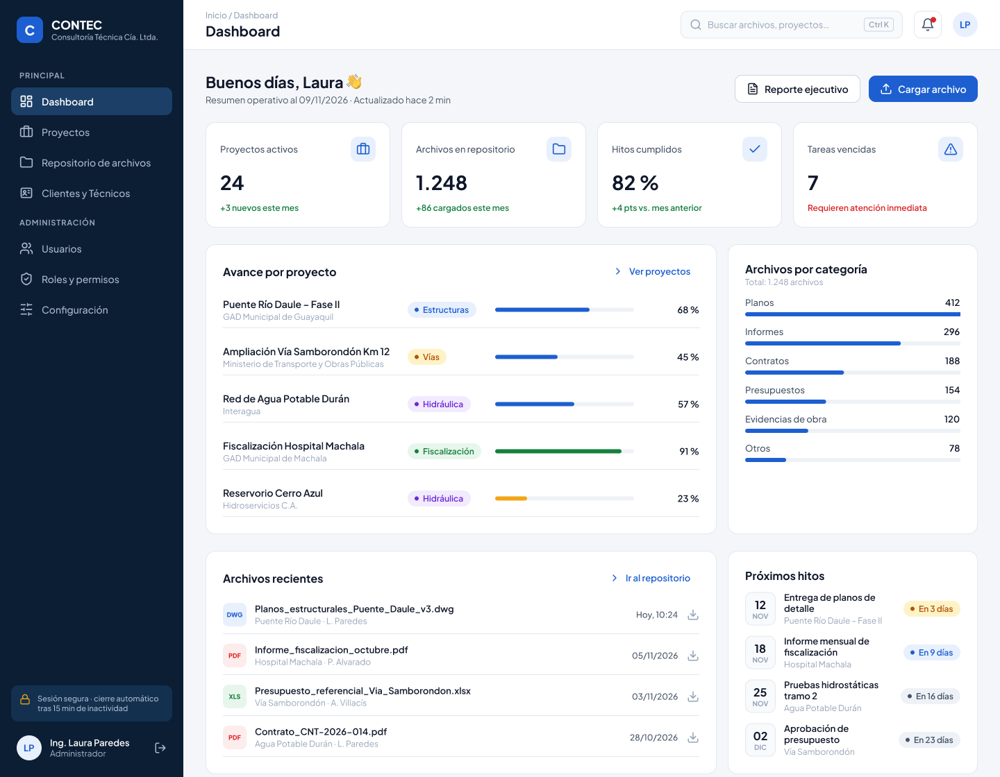

# Nucitas · Sistema de Gestión de Archivos CONTEC

Repositorio de evidencias del proceso de ingeniería de requerimientos y del prototipo de un sistema de gestión de archivos para **Consultoría Técnica Cía. Ltda. (CONTEC)**.

**Ingeniería de Software I · Paralelo 3 · 2026 PAO II · Grupo 4 «Nucitas»**

[Ver diseño en Figma](https://www.figma.com/design/H5indaf4oTeU7FQqVIQc3X/Prototipo?node-id=3-2&p=f&t=mYujpwWtAaLxwJ4f-0) · [Explorar pantallas](prototipo/) · [Consultar tablero Scrum](evidencias/metodologia/TABLERO_SCRUM.md) · [Consultar historias de usuario](evidencias/metodologia/historias_usuario.csv)



## 1. Objetivo y alcance

El sistema propuesto busca centralizar la documentación de los proyectos de CONTEC y facilitar su consulta por parte de gestores de proyectos, técnicos, directivos y administradores.

El alcance especificado en las historias de usuario comprende:

- Carga de archivos con metadatos y asociación con clientes o técnicos.
- Listado y búsqueda de documentos mediante filtros combinados.
- Previsualización, descarga y eliminación con confirmación.
- Consulta del directorio de clientes y técnicos.
- Administración de cuentas de usuario, roles y permisos.

La documentación reúne las evidencias del levantamiento de requerimientos, la organización del trabajo y el diseño de las interfaces del sistema.

## 2. Contenido del repositorio

Acceso a los principales materiales del proyecto:

| Material | Descripción | Acceso |
|---|---|---|
| Evidencias de levantamiento | Capturas de entrevistas, reuniones y convocatorias con CONTEC. | [Entrevistas](evidencias/entrevistas/) · [Reuniones](evidencias/reuniones/) |
| Metodología y requerimientos | Tablero Scrum, backlog, historias de usuario y criterios de aceptación. | [Metodología](evidencias/metodologia/) |
| Prototipo | Diseño en Figma y 11 pantallas exportadas en PNG. | [Pantallas del sistema](prototipo/) |

## 3. Evidencias de levantamiento de requerimientos

Las evidencias gráficas se organizan por actividad para facilitar su identificación.

| Actividad | Archivo | Descripción |
|---|---|---|
| Entrevista | [ENTREVISTA.jpeg](evidencias/entrevistas/ENTREVISTA.jpeg) | Captura de una sesión en Google Meet con participantes y pantalla compartida. |
| Convocatoria de entrevista | [MEET.png](evidencias/entrevistas/MEET.png) | Invitación de calendario titulada «ENTREVISTA CONTEC». |
| Reunión con el cliente | [REUNIONES.jpeg](evidencias/reuniones/REUNIONES.jpeg) | Captura de la sesión «Reunión cliente CONTEC» en Microsoft Teams. |
| Convocatoria de reunión | [TEAMS.png](evidencias/reuniones/TEAMS.png) | Invitación de la reunión del 29 de octubre de 2026. |

El [tablero Scrum](evidencias/metodologia/TABLERO_SCRUM.md) describe el uso de entrevistas semiestructuradas y observación directa como técnicas de levantamiento. Las capturas reúnen las sesiones y convocatorias registradas durante este proceso.

## 4. Metodología y gestión de requerimientos

La metodología del proyecto sigue un enfoque de **Scrum adaptado a la ingeniería de requerimientos**, organizado en cuatro sprints:

| Sprint | Fase | Objetivo |
|---|---|---|
| 1 | Elicitación y descubrimiento | Comprender el problema y levantar necesidades mediante entrevistas y observación. |
| 2 | Análisis y negociación | Elaborar, priorizar y estimar las historias de usuario. |
| 3 | Especificación | Definir requerimientos funcionales y no funcionales, criterios de validación y prototipo. |
| 4 | Validación y verificación | Revisar los requerimientos y el prototipo con el cliente. |

### Artefactos del proyecto

| Artefacto | Contenido | Acceso |
|---|---|---|
| Tablero Scrum | Equipo y responsabilidades, sprints, tareas, backlog, criterios de aceptación, Definition of Ready, Definition of Done y matriz de trazabilidad HU–RF–RNF–pantallas | [TABLERO_SCRUM.md](evidencias/metodologia/TABLERO_SCRUM.md) |
| Backlog exportado | 10 historias, de HU-01 a HU-10, con prioridad MoSCoW, estimación, responsable, sprint y estado; total de 48 story points | [historias_usuario.csv](evidencias/metodologia/historias_usuario.csv) |

El tablero también describe el formato de historias **Como / quiero / para**, los criterios **INVEST**, la estimación con **Planning Poker** y criterios de aceptación en formato **Dado / Cuando / Entonces**. Los identificadores RF y RNF remiten a la ERS del proyecto.

## 5. Prototipo del sistema

**Diseño en Figma:** [abrir prototipo CONTEC](https://www.figma.com/design/H5indaf4oTeU7FQqVIQc3X/Prototipo?node-id=3-2&p=f&t=mYujpwWtAaLxwJ4f-0).

Las siguientes exportaciones permiten revisar las interfaces directamente desde el repositorio. Los vínculos HU/RF relacionan cada pantalla con el backlog; las imágenes representan el comportamiento propuesto del sistema.

| N.º | Pantalla | Alcance representado | Relación con el backlog |
|---|---|---|---|
| 01 | [Iniciar sesión](prototipo/01_Iniciar_sesi%C3%B3n.png) | Acceso de usuarios al sistema | Acceso transversal |
| 02 | [Dashboard](prototipo/02_Dashboard.png) | Resumen operativo y accesos a los módulos | Vista general |
| 03 | [Proyectos](prototipo/03_Proyectos.png) | Organización de proyectos | Contexto de la gestión documental |
| 04 | [Repositorio de archivos](prototipo/04_Repositorio__archivos.png) | Listado, filtros de búsqueda y acción de descarga | HU-03 / RF-003; HU-04 / RF-004; HU-06 / RF-006 |
| 05 | [Cargar archivo](prototipo/05_Cargar_archivo.png) | Carga, metadatos y asociación con clientes o técnicos | HU-01 / RF-001; HU-02 / RF-002 |
| 06 | [Vista previa del archivo](prototipo/06_Vista_previa__archivo.png) | Consulta del contenido del documento | HU-05 / RF-005 |
| 07 | [Eliminar archivo](prototipo/07_Eliminar_archivo.png) | Confirmación de eliminación | HU-07 / RF-007 |
| 08 | [Clientes y técnicos](prototipo/08_Clientes_T%C3%A9cnicos.png) | Consulta del directorio | HU-08 / RF-008 |
| 09 | [Gestión de usuarios](prototipo/09_Gesti%C3%B3n_usuarios.png) | Administración de cuentas | HU-09 / RF-009 |
| 10 | [Roles y permisos](prototipo/10_Roles_permisos.png) | Configuración de permisos | HU-10 / RF-010 |
| 11 | [Sesión expirada](prototipo/11_Sesi%C3%B3n_expirada.png) | Estado de expiración de sesión | Seguridad de sesión transversal |

### Recorrido del prototipo

1. Revisar el inicio de sesión, el dashboard y la vista de proyectos.
2. Abrir el repositorio de archivos e identificar el listado y los filtros.
3. Revisar la carga de archivos, los metadatos, las asociaciones y los mensajes de validación.
4. Examinar la vista previa, la acción de descarga y la confirmación de eliminación.
5. Consultar las pantallas de clientes y técnicos, usuarios, roles y permisos.
6. Revisar el estado de sesión expirada y contrastar las pantallas con los criterios de aceptación del tablero.

## 6. Estructura del repositorio

```text
Nucitas/
├── README.md
├── evidencias/
│   ├── entrevistas/
│   │   ├── ENTREVISTA.jpeg
│   │   └── MEET.png
│   ├── reuniones/
│   │   ├── REUNIONES.jpeg
│   │   └── TEAMS.png
│   └── metodologia/
│       ├── TABLERO_SCRUM.md
│       └── historias_usuario.csv
└── prototipo/
    └── 11 pantallas exportadas en PNG
```

## 7. Equipo de trabajo

El equipo combina la gestión de requerimientos, la coordinación del trabajo, el diseño de interfaces y el aseguramiento de la calidad.

| Integrante | Rol | Responsabilidad principal |
|---|---|---|
| Misael José Moreira Moreno | Product Owner | Priorización del backlog y validación de historias con el cliente. |
| Braulio Alexander Neira Villón | Scrum Master | Organización de sprints, tablero y evidencias. |
| Danna Stefania Urdanigo Ochoa | Diseñadora UX | Diseño del prototipo y flujos de ventanas. |
| Kevin Fernando Maldonado Paredes | Analista QA | Criterios de aceptación, requerimientos no funcionales y métodos de verificación. |
